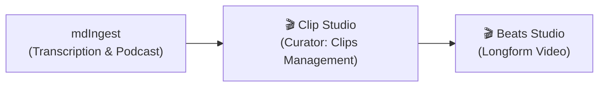

# DeepDive Media Automator (DDMA)

DeepDive Media Automator (DDMA) is a progressive media automation engine powered by **Google Antigravity**.

> **DDMA is an extension to [mdIngest](https://github.com/ashutoshmjain/mdIngest).** mdIngest is the base application — it is the entry point, runs transcription (the podcast stage), and hosts the Publishing Cockpit and the workspace landing page. **Install mdIngest first and follow its install instructions (including dd_hub setup) in the [mdIngest README](https://github.com/ashutoshmjain/mdIngest/blob/main/README.md).** DDMA adds two things on top of mdIngest: **Clip Studio** (the Curator — Clips management) and **Beats Studio** (longform video).

---

## 💡 The DDMA Philosophy: A Ground-Up Inversion of Media Production

Typically, when creating a podcast, video, or movie, creators follow a **top-down paradigm**:
1. Record hours of raw audio and video.
2. Spend days editing a master long-form podcast or film first.
3. Slice out short trailers or highlights after the fact for social media platforms like TikTok, Instagram Reels, or YouTube Shorts.

**DDMA takes a fundamentally different, ground-up approach—a total inversion of traditional media workflows.**

Rather than slicing down a monolithic master recording, DDMA builds media **bottom-up from first-principles micro-chunks**:
1. **Intelligent Short-Form First**: DDMA ingests raw audio, transcribes it at the word level, and intelligently splits it into autonomous, high-density **~2-minute short clips** optimized specifically for social media engagement.
2. **Emergent Long-Form Outcomes**: When each standalone short clip is perfected (with dynamic title cards, background music ducking, and motion graphics), the long-form audio podcast (Spotify/Apple) and long-form infographic video (YouTube) **emerge naturally as downstream outcomes** by compiling these micro-clips.

> 🎯 **If every 2-minute short is great, the resulting long-form podcast or video is guaranteed to be a filler-free master artifact.**

---

## ⚙️ Creative Automation vs. Social Media Scheduling

> [!NOTE]
> **What "Automation" Means in DDMA**:
> Automation in DDMA does **NOT** mean auto-posting videos directly to TikTok or fetching analytics from Instagram.
> Instead, **DDMA automates the creative production process itself**—intelligent topic segmentation, sub-second word-level snapping, automated audio ducking and crossfading, motion-graphics rendering, and seamless bottom-up long-form video demuxing.

---

## 🧩 What DDMA brings: Clip Studio + Beats Studio

DDMA extends mdIngest with two studios. Transcription runs in mdIngest (the podcast stage) — DDMA works from the transcription and the plan, and does not transcribe.



1. **🎬 Clip Studio (the Curator)** — Clips management. The Curator web app (`http://localhost:8000/curator.html`) manages episodes and clips: it cuts clip-scoped audio from the continuous episode audio, muxes the 740×740 draft, sends it to Mosaic for AI motion graphics, compiles the final 1080×1920 vertical reels (intro card + Mosaic body + outro, with captions), and publishes finished clips to GitHub with the per-clip Publish button (scoped: the clip + the episodes manifest only).

2. **🎬 Beats Studio (longform video)** — A separate server process (port 8001) living in `ddma/`, launched from the mdIngest landing page. It turns finished clips into longform video: it divides each clip into ~7.5s beats for the Manim process, stitches Mosaic renders into a horizontal 1920×1080 video, and can retrigger a Mosaic run from the longform if an asset didn't fit (explicit user trigger only).

---

> [!IMPORTANT]
> 💻 **Minimum Hardware Specifications & System Requirements**:
> Because DDMA performs local AI speech-to-text transcription (Whisper), high-definition video stream remuxing (FFmpeg), and dynamic image overlays (Pillow), we recommend the following minimum hardware configuration:
> * **CPU**: Quad-Core Processor (Intel Core i5 8th Gen+ / AMD Ryzen 5 3000+ or Apple Silicon M1/M2/M3).
> * **RAM**: **8 GB Minimum** (16 GB Recommended for handling multi-hour audio files, Whisper model weights, and 1080p/740p video rendering smoothly).
> * **Disk Storage**: **10 GB Free Disk Space** (for Python libraries, PyTorch weights, FFmpeg binaries, and temporary media clip buffers).
> * **GPU (Optional)**: NVIDIA GPU with CUDA support for accelerated transcription (automatically falls back to CPU if no GPU is available).
> * **Supported Operating Systems**: Windows 10/11 (with WSL2), macOS 12+, or Ubuntu Linux 20.04+.

---


## 🗄️ Setting up dd_hub (the workspace)

dd_hub is the workspace — a Google Drive folder that holds the plan, settings, inputs, working assets, and audio/video outputs. DDMA reads from and writes to dd_hub. GitHub is only the intermediary for the *published* Active Master clips; dd_hub is the live workspace.

**Set up dd_hub by following the install instructions in the [mdIngest README](https://github.com/ashutoshmjain/mdIngest/blob/main/README.md).** mdIngest is the base application — its README covers the full setup (Windows easy path via the Antigravity app, Linux manual path with rclone, the vault, and verification). DDMA uses the same dd_hub workspace; there is nothing DDMA-specific to set up beyond that.

> [!IMPORTANT]
> **The core rule**: The code only does **local file I/O against a local path**. It **never** calls the Google Drive web API for file access. So dd_hub must be mounted as a local filesystem path on every machine that runs DDMA. The code reads the mount path from the `DD_HUB_ROOT` environment variable.

---

## ⚡ Setup & Quickstart Guide

**Install mdIngest first and follow its install instructions (including dd_hub setup) in the [mdIngest README](https://github.com/ashutoshmjain/mdIngest/blob/main/README.md).** DDMA is an extension to mdIngest — it uses the same toolchain, the same dd_hub workspace, and the same settings vault. There is no separate DDMA install.

Once mdIngest is set up, launch the two DDMA studios:

* **Clip Studio (the Curator)** — start the Curator server:
  ```bash
  python scratch/run_curator.py
  ```
  Open 👉 **[http://localhost:8000/curator.html?project=episode_245](http://localhost:8000/curator.html?project=episode_245)** (replace `episode_245` with your episode). The Curator is where you manage clips, cut audio, run Mosaic, compile the vertical reels, and Publish finished clips to GitHub.
* **Beats Studio (longform video)** — launch it from the mdIngest landing page (`http://localhost:8088/`, the "Launch Beats Studio" button). It runs on port 8001. Beats Studio turns finished clips into longform video.

---

## 📖 Full Documentation & Interactive Guide

For complete step-by-step guides, advanced CLI reference (`ddma.py`), fast demuxer specifications, and REST API documentation, open the interactive documentation page:
👉 **[DDMA Documentation & Developer Guide](docs/documentation.html)** *(also available directly inside the Curator Dashboard via the **`📖 Docs`** button)*.

---

## 🌌 Key Features & Capabilities

* **Multi-Project Management**: Curate multiple episodes side-by-side with local audio files, word-level Whisper transcripts, and clip plans in project-specific workspaces.
* **Collapsible & Resizable IDE-style Layout**: Drag dividers to adjust transcription/clips real estate. Collapse the sidebar to maximize focus.
* **Word-Level Curation & Timeline Snapping**: Double-click or select transcript words to set precise sub-second boundaries. Highlights used ranges to prevent overlapping selections.
* **Per-Segment Music Volume Mixer**: Mix background music stings. Set individual duration, crossfade transition, and custom volume level multipliers (e.g. `0.20` for subtle background ducking).
* **Global Sting Manager**: Upload new music stings directly through the settings panel to make them globally available.
* **Theme Customization**: Switch between **Nordic Breeze (Light)**, **Cyberpunk (Neon Cyan/Purple)**, and **Midnight (Dark default)**.
* **Dynamic Exporters & Instant Demuxing**:
  * **Audio (`.mp3`)**: Compiles mixed segments directly.
  * **Fast Video Demuxer (`.mp4`)**: Lossless `-c copy` stream stitching concatenates 40-minute episode files in 2–4 seconds!
* **Automatic Title Card Intro Prepending**: Pillow generates clean title cards with multi-line wrapping and joins them to the master clip using FFmpeg timescale normalization.
* **Mosaic AI Ingest & Recovery Integration**:
  * **Automated Upload & Execution**: Export local draft video compiles directly to the Mosaic API for AI motion graphics overlays.
  * **Self-Healing Recovery & Cache**: Automatically resumes background polling/download threads across server restarts and browser reloads.
* **🔄 Granular AI Remixing & In-Context Recasting**:
  * Click `🔄 Remix` on any clip to recast it using Gemini (analyzing preceding locked clips for style, pacing, and curiosity questions).
* **🎬 Editor's Preview Player & E2E Testing**:
  * **Consolidated Single-Player Engine**: Plays all selected clips sequentially with WebAudio/HTML5 volume synchronization.
  * **Automated E2E Test Suite**: Headless Puppeteer test scripts (`scratch/test-env/test_curator.js` & `scratch/test-env/test_player.js`) ensure 100% regression-free updates.

---

## 🐛 Bug tracking

We do **not** manage issues on GitHub. Bugs and fixes for DDMA, the deepDive pipeline, mdIngest, and the portfolio app are tracked in the [Bug Tracker Space](https://muse.ai/s/bug-tracker-ixe6daxhoezyxy/g1O341vEl5aXYIzWFP1db5l-xunGJAxBRSwSJccC110) — a read-only list of all bugs with their status.

